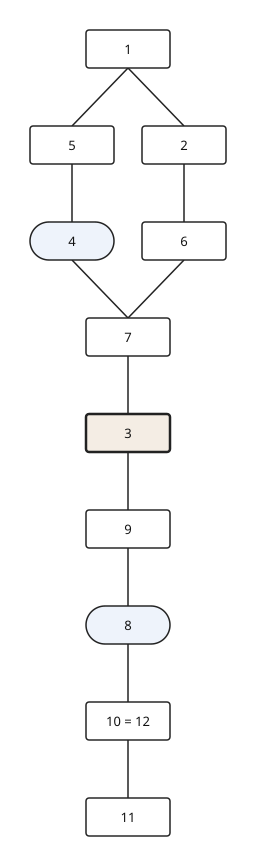

# harris-matrix

**Registrar, verificar y dibujar la estratigrafía arqueológica** (excavación y arqueología paramental) desde ficheros CSV. Sin dependencias en tiempo de ejecución.

🇬🇧 [Read in English](README.md)

> Estado: **alfa (0.1)**. Funcionan el modelo base, `verify` y `render` a SVG. El modelo de datos es un borrador sin contrastar con arqueólogos de campo ([diseño](docs/modelo-de-datos.md)).



## Uso

```bash
pip install -e .
harris-matrix verify examples/demo
harris-matrix --lang es verify examples/con-errores
harris-matrix render examples/demo -o matriz.svg
```

Una carpeta con `ues.csv` (`ue_id`, `tipo_unidad`, `subtipo`, `descripcion`) y `relaciones.csv` (`ue_origen`, `tipo`, `ue_destino`, `certeza`). La UE de origen es **posterior** a la de destino. Tipos: `cubre`, `corta`, `rellena`, `se_apoya_en`, `se_une_a`, `igual_a`, `posterior_a` (y sus inversas).

Verificación (R01–R05, R10–R16): duplicados, referencias inexistentes, vocabulario, tipos admitidos, ciclos, cortes sin relleno, UE huérfanas, relaciones redundantes. Los ciclos salen en rojo en el SVG. Código de salida distinto de cero si hay errores; `--json` para salida automática.

Principios: se registran hechos, el orden y el gráfico se derivan; toda relación lleva certeza; la ausencia de relación no implica contemporaneidad.

## Desarrollo

```bash
pip install -e ".[dev]" && pytest
PYTHONPATH=src python3 -m unittest discover -s tests
```

## Licencia

Pendiente de decidir antes de publicar.
