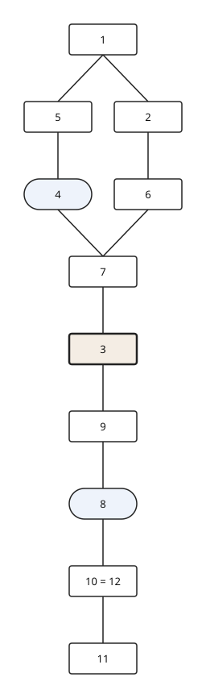
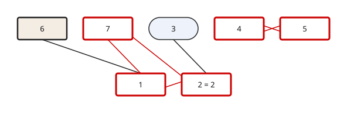

# harris-matrix

**Record, verify and draw archaeological stratigraphy** (excavation and standing-buildings archaeology) from plain CSV files. Zero runtime dependencies.

🇪🇸 [Leer en español](README.es.md)

> Status: **alpha (0.1)**. The core model, `verify` and SVG `render` work; chronological/spatial rules and the hmdp adapter are planned. The data model is a draft not yet reviewed by field archaeologists (see the [design](docs/data-model.md)).



## How it works

```
 units.csv -------+
                  +--> model --> temporal graph --+--> verify --> report (text/JSON)
 relations.csv ---+    (same_as merged)           |              exit code 1 on errors
                                                  +--> render --> editable SVG
```

Facts are recorded (which unit covers, cuts or fills which); order and drawing are **derived**. Every relation carries a certainty (`certain`, `probable`, `doubtful`), drawn as solid, dashed or dotted lines. Absence of a relation never implies contemporaneity.

## Quick start

```bash
pip install -e .
harris-matrix verify examples/demo
harris-matrix render examples/demo -o matrix.svg
```

Input is a folder with two UTF-8 CSV files.

**`units.csv`**

| Column | Meaning |
| --- | --- |
| `unit_id` | identifier (text, e.g. `1045b`) |
| `unit_type` | `deposit` · `interface` · `structure` · `virtual` |
| `subtype`, `description` | optional |

**`relations.csv`**

| Column | Meaning |
| --- | --- |
| `from_unit`, `type`, `to_unit` | the `from_unit` is **later** than the `to_unit` |
| `certainty` | `certain` (default) · `probable` · `doubtful` |

Relation types: `covers`, `cuts`, `fills`, `rests_on`, `bonded_to`, `same_as`, `later_than`. Inverse names (`covered_by`, `cut_by`...) are accepted.

## Verification

```console
$ harris-matrix verify examples/with-errors
error   R01  units.csv:9          Duplicate unit 2 (also on row 3)
error   R02  relations.csv:4      Relation refers to missing unit 99
error   R03  relations.csv:8      Unknown relation type: 'touches'
error   R04  relations.csv:7      6 cuts 1: not allowed between 'structure' and 'deposit'
error   R05  relations.csv:9      Unit 2 is related to itself
error   R10  relations.csv        Cycle in the sequence: 1 -> 2 -> 7 -> 1
error   R11  relations.csv        Direct contradiction between 4 and 5
warning R14  units.csv:4          Cut 3 has no recorded fill
warning R15  units.csv:7          Unit 6 has no relations
7 errors, 2 warnings, 0 notes
```

Implemented: R01–R06 and R10–R16 (duplicates, dangling references, vocabulary, allowed unit types, cycles, `same_as` conflicts, unfilled cuts, orphans, transitive redundancy). Use `--json` for machine output.

Cycles are highlighted in red in the SVG:



## SVG output

Editable in Inkscape or Illustrator: one `<g id="unit-1045" data-type="…">` per unit (units joined by `same_as` share a node, e.g. `10 = 12`); rectangles for deposits, rounded for interfaces, thick for structures; styles embedded.

## Python API

```python
from harris_matrix import load_project, verify, render_svg

project = load_project("examples/demo")
issues = verify(project)            # list of Issue(code, severity, message, row, file)
svg = render_svg(project)           # SVG as a string
```

Projects can also be built in code: `Project(units=[Unit("1", "deposit")], relations=[Relation("1", "covers", "2")])`.

## Roadmap

- Dates, phases and propagation rules (R30–R34); spatial checks (R20–R23)
- Wide input format (one row per unit) and standing-buildings vocabulary
- DOT/GraphML export; [hmdp](https://www.iosa.it/specs/harris-matrix-data-package/) import/export
- Better routing of edges spanning several levels
- Optional nanopublication export

## Development

```bash
pip install -e ".[dev]" && pytest
# or, with nothing installed:
PYTHONPATH=src python3 -m unittest discover -s tests
```

## License

To be decided before the first public release.
